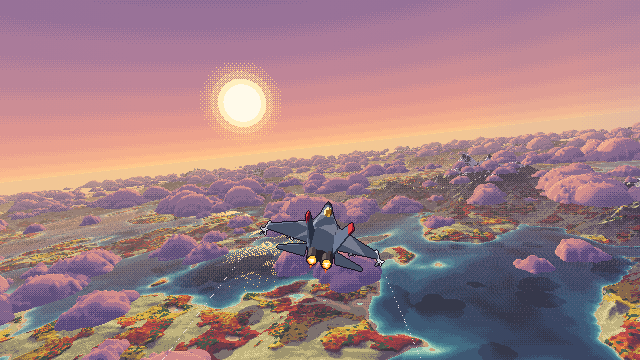

# Dusk Patrol

A pixel-art fighter-jet flying toy for the browser. Fly over autumn lake country at the last light of day.

**[Play it](https://nearbycoder.github.io/dusk-patrol/play/)** · **[Website](https://nearbycoder.github.io/dusk-patrol/)**

The whole game is one self-contained file, [`index.html`](index.html), about 170 KB. There are no libraries and no image assets. The world is raw WebGL2, the cockpit is Canvas 2D, sound is Web Audio, and everything is drawn by code. The only external requests are two Google Fonts.

## Controls

| Input | Action |
| --- | --- |
| Mouse | Steer. In the top view the jet flies toward the cursor. In chase and cockpit, the cursor's offset from centre sets turn and climb/dive |
| Click | Barrel roll |
| Hold left button | Afterburner |
| Right click or `F` | Fire a missile. Four sit on the wings, and each re-arms after a few seconds |
| `Space` | Cycle views: top-down (north up), chase, cockpit |
| `M` or the sound button | Toggle synthesised sound (off by default) |
| Touch | Drag to steer; on-screen FIRE, BOOST (hold), ROLL and VIEW buttons |

Extras: `Shift` for afterburner, `R` to roll, mouse wheel for altitude in the top view.
The jet flies lazy S-turns until you first move the mouse. It can't crash: it pulls up on its own before terrain and skims water at about 10 m.

## How it works

- **World:** at load, web workers generate a seamlessly tiling 2048² height field at 10 m spacing, covering 20.48 km. It comes with a biome map (forest patches, autumn hue, conifers, ambient occlusion), baked shadow heights for the low sun, and a max-mip pyramid. A second worker grows a 1024² signed height field of cumulus with its own self-shadowing.
- **Rendering:** a fragment shader ray-marches every pixel using hierarchical max-mip traversal, with an exact bilinear-patch intersection at the leaves, so any camera angle works. Clouds use the same traversal on their own pyramid.
- **Look:** the internal resolution is about 340 px tall, upscaled by a whole-number factor with nearest-neighbour sampling. Every colour comes from hand-picked ramps, with 4×4 Bayer dithering in a narrow band at each tone boundary. The resolution steps down automatically if frames get slow.
- **Aircraft:** low-poly meshes built in code, flat-shaded in three tones with splinter camo and a one-pixel outline pass. The jet's shadow on ground, water and cloud comes from a small orthographic mask.
- **Cockpit and HUD:** plotted pixel by pixel on a Canvas 2D surface, and every reading comes from the flight model. The HUD's pitch ladder is projected through the real camera, so it sits on the true horizon.

## Repository layout

| Path | What it is |
| --- | --- |
| `index.html` | The game. Open it directly or serve the folder |
| `site/` | The marketing site: page, styles, script and screenshots |
| `scripts/build-site.sh` | Assembles `_site/`: the site at `/`, the game at `/play/` |
| `.github/workflows/pages.yml` | Builds and deploys `_site/` to GitHub Pages on every push to `main` |

Preview the website locally:

```sh
sh scripts/build-site.sh && python3 -m http.server 8000 -d _site
```

## Embedding

`index.html?attract` runs a silent autopilot with no UI and no input. The website uses it as its live hero background. An embedding page can post `{dusk: 'pause'}` or `{dusk: 'resume'}` to the frame, and the game posts `{dusk: 'ready'}` once it is flying.

`window.DUSK` exposes state and helpers used by the headless checks, for example `state()`, `setView()`, `fire()`, `advance(seconds)`, `teleport()` and `checkFinite()`.
